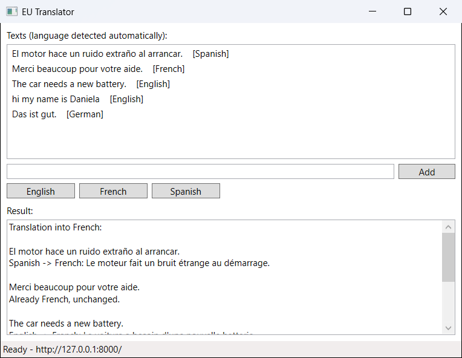

# EU Translator

Offline translation between English, Spanish and French with automatic language detection
(24 EU languages), using models trained from scratch on public datasets.

In plain words: you type a text in any EU language, the program recognises the language, and
with one click it translates the text into English, French or Spanish. Everything runs on your
own computer; nothing is sent to the internet. How it works, without technical terms:
[docs/HOW_IT_WORKS.md](docs/HOW_IT_WORKS.md).



| Folder | What it is |
|--------|------------|
| [TranslatorServer/](TranslatorServer/) | Python REST API server with our own trained models (Transformer translation en/es/fr, language detection for 24 languages), load balancer, tests. Runs from source or as the bundled `TranslatorServer.exe`. See its [README](TranslatorServer/README.md). |
| [TranslatorTraining/](TranslatorTraining/) | Scripts, data and logs to train both models; writes them into `TranslatorServer/models/`. Only needed to retrain. See its [README](TranslatorTraining/README.md). |
| [TranslatorDesktop/](TranslatorDesktop/) | Windows desktop app (.NET 5 WPF) that uses the API. Starts `TranslatorServer.exe` in the background when no API is running. |
| [docs/](docs/) | Full documentation (see below) |

## Documentation

| Document | Contents |
|----------|----------|
| [docs/HOW_IT_WORKS.md](docs/HOW_IT_WORKS.md) | **Plain-language explanation** with screenshots: how the language is recognised, how a sentence is translated, where the training data comes from, how good it is, glossary |
| [docs/SETUP_GUIDE.md](docs/SETUP_GUIDE.md) | **Start here:** step-by-step setup and running, from a new PC to a working translator |
| [docs/PYTHON_API_SETUP.md](docs/PYTHON_API_SETUP.md) | Install and run the Python API: single instance or load-balanced cluster, API reference, configuration, logs, tests, troubleshooting |
| [docs/DOTNET_APP_SETUP.md](docs/DOTNET_APP_SETUP.md) | Build and run the .NET 5 desktop app, standalone build, usage, how it connects, troubleshooting |
| [docs/MODEL_TRAINING.md](docs/MODEL_TRAINING.md) | Training both models from scratch: datasets (downloaded from GitHub only, with every download address), every script and reference file, settings, exact training history, scores |
| [docs/ARCHITECTURE.md](docs/ARCHITECTURE.md) | Running logic: request flow, load balancer, supervisor, desktop app, logging |
| [docs/EU_Translator_Data_Training_API.pdf](docs/EU_Translator_Data_Training_API.pdf) / [.docx](docs/EU_Translator_Data_Training_API.docx) | The data, training and API documentation as one PDF / Word document |

Quick start. You need Git and Python 3.11+; setup downloads the .NET 5 SDK itself, and the
trained models are included:

```powershell
.\check_network.cmd                       # optional: which download sites are blocked
.\setup.cmd                               # Python environment + .NET 5 SDK + app build
.\build_desktop_exe.cmd                   # app + bundled server: publish\TranslatorDesktop\
publish\TranslatorDesktop\TranslatorDesktop.exe   # starts the server in the background by itself
```

Or from source, in two windows:

```powershell
TranslatorServer\start_cluster.bat 4      # window 1: API on http://127.0.0.1:8000
.\run_desktop.cmd                         # window 2: desktop app on .NET 5
```

Behind a corporate proxy, add `--proxy http://host:port` to `check_network.cmd`, `setup.cmd`,
`download_data.cmd`, `build_server_exe.cmd` and `build_desktop_exe.cmd`. Step by step: [docs/SETUP_GUIDE.md](docs/SETUP_GUIDE.md).

| Script | What it does |
|--------|--------------|
| [check_network.cmd](check_network.cmd) | Tests whether each download site is reachable or blocked, and why |
| [setup.cmd](setup.cmd) / [setup.ps1](setup.ps1) | Creates `TranslatorServer\.venv`, installs the packages, installs the .NET 5 SDK into `.dotnet\`, builds the app. Options: `--proxy`, `--training` (`TranslatorTraining\.venv`), `--gpu`, `--serverexe`, `--wheels`, `--runtests` |
| [build_server_exe.cmd](build_server_exe.cmd) | Builds the bundled server `TranslatorServer.exe` with PyInstaller (Python, PyTorch and the models in one folder); `--proxy` |
| [run_server.cmd](run_server.cmd) | Starts that exe: `--instances N`, `--single`, `--host`, `--port` |
| [build_desktop_exe.cmd](build_desktop_exe.cmd) | Builds the standalone desktop app `publish\TranslatorDesktop\TranslatorDesktop.exe` with `TranslatorServer.exe` next to it (builds the server exe if needed); `--rebuildserver`, `--proxy` |
| [run_desktop.cmd](run_desktop.cmd) | Starts the desktop app (Debug build) on the .NET 5.0.17 runtime |
| [download_data.cmd](download_data.cmd) | Downloads the training data from GitHub into `TranslatorTraining\data\` (only for retraining); `--proxy` |

## Desktop app

One plain window with standard Windows controls only, no styles:

- **Texts** list at the top. Type a text in the box below it and press **Enter** or **Add**: it
  appears in the list with its detected language, e.g. `El motor hace un ruido extraño al
  arrancar.    [Spanish]` (any of the 24 EU languages is detected).
- **English**, **French**, **Spanish** buttons: translate every text in the list into that
  language.
- **Result** box at the bottom: per text the original and the translation, e.g.
  `Spanish -> French: Le moteur fait un bruit étrange au démarrage.` Texts already in the target
  language, or in a language the model cannot translate (e.g. German), are listed as unchanged.

The API server is a separate program. When the app starts and no API answers at its address
(`http://127.0.0.1:8000` by default), it **starts `TranslatorServer.exe` itself as a hidden
background process**, waits for it to load the models, and stops it again when the window closes
(also if the app is killed: the server runs in a Windows job object tied to the app). If an API is
already running, the app just uses it and leaves it running.

```powershell
.\build_desktop_exe.cmd                     # publish\TranslatorDesktop\TranslatorDesktop.exe + TranslatorServer\
publish\TranslatorDesktop\TranslatorDesktop.exe
```

The `publish\TranslatorDesktop` folder contains both programs (the .NET 5 runtime and Python are
included) and can be copied to any Windows 10/11 x64 PC.

### Running the parts separately

The API can also be started on its own (for example on a server for several PCs):

```powershell
TranslatorServer\start_cluster.bat 4       # from source: 4 instances behind a load balancer on :8000
TranslatorServer\start_api.bat             # from source: a single instance on :8000
.\run_server.cmd --instances 4             # the bundled exe (after build_server_exe.cmd)
```

All listen on `http://127.0.0.1:8000`; Ctrl+C stops them. The cluster spreads requests over the
instances, restarts crashed ones and writes JSON logs to `TranslatorServer\logs\`. See
[TranslatorServer/README.md](TranslatorServer/README.md#scaling-load-balancer). Set
`TRANSLATOR_HOST=0.0.0.0` before starting it to accept connections from other machines.

The desktop app targets **.NET 5** (`net5.0-windows`) and is built with the **.NET 5 SDK
5.0.408**, pinned in [global.json](global.json). `setup.cmd` installs that SDK, with its 5.0.17
runtime, into `.dotnet\` and builds the Debug version:

```powershell
.\run_desktop.cmd                              # Debug build on the .NET 5.0.17 runtime in .dotnet\
.\run_desktop.cmd --url http://server:8000     # use the API on another machine
```

The Debug build finds the server exe in `TranslatorServer\dist\TranslatorServer\` (after
`build_server_exe.cmd`); without it, start the API yourself. .NET 5 itself is out of support since
May 2022.

| Setting | Default | Meaning |
|---------|---------|---------|
| `--url` argument or `TRANSLATOR_URL` | `http://127.0.0.1:8000` | Address of the API |
| `--server PATH` or `TRANSLATOR_SERVER_EXE` | next to the app, else found in the repository | `TranslatorServer.exe` to start when no API is running (only for a local address) |
| `--server-args "..."` or `TRANSLATOR_SERVER_ARGS` | `--single` | How to start it, e.g. `"--instances 2"` for a cluster |
