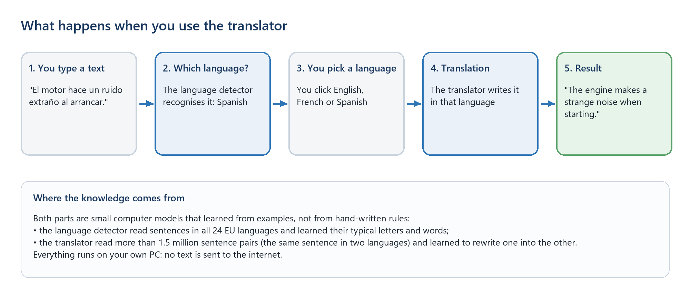

# Architecture and running logic

How the parts of the EU Translator work together at runtime.

> **In plain words:** the desktop app is only the window. It sends each text to the translation
> server, which first recognises the language and then translates. For many users the server can
> run several copies of the translator side by side, with a load balancer in front that hands each
> request to a free copy and restarts copies that fail. A non-technical explanation with pictures
> is in [HOW_IT_WORKS.md](HOW_IT_WORKS.md).



* Setup: [PYTHON_API_SETUP.md](PYTHON_API_SETUP.md) · [DOTNET_APP_SETUP.md](DOTNET_APP_SETUP.md)
* Models: [MODEL_TRAINING.md](MODEL_TRAINING.md)

## 1. Components

```
┌────────────────────────┐        HTTP (JSON)        ┌──────────────────────────────────────────────┐
│ TranslatorDesktop       │  ───────────────────────> │ loadbalancer.py  :8000                         │
│ (.NET 5 WPF, separate)  │  <─────────────────────── │  least-connections, health checks, retries     │
└────────────────────────┘                           └───────┬──────────────┬──────────────┬─────────┘
          (any other HTTP client works the same)             v              v              v
                                                    ┌──────────────┐ ┌──────────────┐ ┌──────────────┐
                                                    │ app.py :8001 │ │ app.py :8002 │ │ app.py :800N │
                                                    │  detector    │ │  detector    │ │  ...         │
                                                    │  translator  │ │  translator  │ │              │
                                                    └──────────────┘ └──────────────┘ └──────────────┘
                                                      cluster.py starts all processes and restarts crashed ones
                                                      every process writes JSON logs to TranslatorServer/logs/
```

| Component | File | Process | Role |
|-----------|------|---------|------|
| Desktop app | [TranslatorDesktop/](../TranslatorDesktop/) | `TranslatorDesktop.exe` | User interface; calls the API over HTTP. Starts `TranslatorServer.exe` in the background when no API is running ([ServerProcess.cs](../TranslatorDesktop/ServerProcess.cs)). |
| Load balancer | [loadbalancer.py](../TranslatorServer/loadbalancer.py) | 1 Python process | Single public address; spreads requests over the instances |
| API instance | [app.py](../TranslatorServer/app.py) | N Python processes | FastAPI app: validation, detection, translation, logging |
| Supervisor | [cluster.py](../TranslatorServer/cluster.py) | 1 Python process | Starts the instances and the load balancer, restarts crashed ones |
| Language detector | [translator/detect.py](../TranslatorServer/translator/detect.py), [lid.py](../TranslatorServer/translator/lid.py) | inside each instance | Detects 24 languages |
| Translator | [translator/engine.py](../TranslatorServer/translator/engine.py), [nmt.py](../TranslatorServer/translator/nmt.py) | inside each instance | Translates en ↔ es ↔ fr |
| Logging | [logsetup.py](../TranslatorServer/logsetup.py) | every process | JSON-lines files + console |

With `start_api.bat` (or `TranslatorServer.exe --single`) there is no load balancer: the client talks to one `app.py` directly on
port 8000. The API is the same either way.

The same code also runs as the bundled `TranslatorServer.exe` (built by `build_server_exe.cmd`):
its entry point [server_main.py](../TranslatorServer/server_main.py) runs the supervisor by default, and
the supervisor starts every instance (`TranslatorServer.exe worker --port 800i`) and the load
balancer (`TranslatorServer.exe balancer …`) as further processes of the same exe.

The models are trained by the separate scripts in [TranslatorTraining/](../TranslatorTraining/),
which import the model code from `TranslatorServer/translator/` and write `TranslatorServer/models/`.

## 2. Life of a translation request

Example: the app translates two rows to French.

1. **Desktop app**: sends `POST /translate` to the load balancer:
   `{"text": [["The car needs a new battery.", "¿Dónde está la estación de tren?"]], "target_lang": "fr"}`.
2. **Load balancer**:
   * gives the request an `X-Request-ID` (or keeps the client's);
   * picks the healthy instance with the fewest requests in progress (round-robin between
     equals) and forwards the request;
   * if that instance cannot be reached, marks it down and retries on another instance;
   * logs the request (instance, status, time) and returns the response with `X-Request-ID`
     and `X-Backend`.
3. **API instance** (`app.py`):
   1. Validates the input with Pydantic: `string[][]`, target en/es/fr, at most `MAX_SENTENCES`.
      Otherwise it returns 422 or 413.
   2. Runs the work in a thread pool (`run_in_threadpool`), so the server keeps accepting
      requests.
   3. **Detection** (`LanguageDetector.detect_many`). Each sentence becomes hashed word and
      character n-gram features, then 24 scores from the LID model, plus the +1.5 prior for
      en/es/fr; the highest wins. With `detect_mode="group"`, each inner array is detected
      as one text. With `source_lang`, detection is skipped.
   4. **Translation** (`Translator.translate_many`). Sentences already in the target language,
      without letters, or in a language the model cannot translate are returned unchanged.
      For the others:
      * paragraphs are split into sentences (line breaks are kept);
      * duplicates are translated once, and repeats come from an LRU cache (20,000 entries);
      * sentences are sorted by length and translated in batches of 32;
      * each sentence gets the tag `<2fr>` in front, is tokenized with SentencePiece, and is
        encoded by the 6-layer encoder;
      * the 2-layer decoder generates the translation with beam search (beam 4) and a key/value
        cache.
   5. Reshapes the results to the input shape and returns `translation`, `detected_lang`,
      `confidence`, `translated`.
   6. Logs one access line and one translation line (sentence count, languages, time) with the
      request id.
4. **Desktop app**: writes each text and its translation into the result box
   ("Spanish -> French: …").

## 3. Load balancer logic ([loadbalancer.py](../TranslatorServer/loadbalancer.py))

| Mechanism | Behaviour |
|-----------|-----------|
| Routing | Least connections among healthy instances; round-robin when several are equal. Translation is CPU-bound, so this keeps all instances equally busy. |
| Health checks | `GET /health` on every instance every 2 s (timeout 3 s). Failing instances are taken out of rotation and put back when they answer again; both changes are logged. |
| Failover | On a connection error or timeout, the instance is marked down and the request is retried on the next healthy instance. Retrying is safe because translating has no side effects. |
| No instance up | `503 {"detail": "No healthy translation instance available"}` |
| Timeouts | Connect 2 s; request 600 s (the largest allowed request, 10,000 sentences, takes about 3 min) |
| Headers | Hop-by-hop headers are dropped; `X-Request-ID`, `X-Forwarded-For` are added towards the instance; `X-Request-ID`, `X-Backend` are added to the response |
| Status | `GET /lb/status`: per instance `healthy`, `active`, `requests`, `errors`, `avg_ms`, `last_error` |

## 4. Supervisor logic ([cluster.py](../TranslatorServer/cluster.py))

1. Starts N instances: `python -m uvicorn app:app --host 127.0.0.1 --port 800i` (in the exe:
   `TranslatorServer.exe worker --host 127.0.0.1 --port 800i`). Each gets
   `TRANSLATOR_INSTANCE=api-800i` and `TRANSLATOR_THREADS = CPU cores / N`.
2. Starts the load balancer with the list of instance URLs.
3. Every second, checks whether any process has exited. If one has, it logs the crash with the
   exit code and starts it again.
4. On Ctrl+C, stops the load balancer, then the instances.

Each instance is a separate process with its own copy of the models (about 500 MB of RAM), so
translations run in parallel on different cores.

## 5. Desktop app logic ([MainWindow.xaml.cs](../TranslatorDesktop/MainWindow.xaml.cs), [ServerProcess.cs](../TranslatorDesktop/ServerProcess.cs))

| Part | Behaviour |
|------|-----------|
| Start | Reads the API URL (`--url` → `TRANSLATOR_URL` → `http://127.0.0.1:8000`) and calls `GET /health` |
| Background server | If no API answers and the address is local, finds `TranslatorServer.exe` (`--server` / `TRANSLATOR_SERVER_EXE`, else `TranslatorServer\` next to the app, else `TranslatorServer\dist\TranslatorServer\` in a parent folder) and starts it hidden with `--single --port <port>` (or `--server-args`). The process is put into a Windows job object with "kill on close", so it ends with the app even if the app is killed; on a normal close the app stops it (with its child processes). A server that was already running is never stopped. |
| Waiting | Polls `GET /health` every second (up to 3 minutes) while the models load; reports if the server process exits |
| Connection monitor | Then `GET /health` every 5 s while up, 2 s while down; the language buttons are enabled only while the API answers |
| Add text | Adds the text to the list and calls `POST /detect`; the list shows the language name (`[Spanish]`) |
| English / French / Spanish | All texts in one `POST /translate` request; the result box lists per text the source language, target language and translation, or why it is unchanged |
| Errors | API unreachable: status bar (the monitor reconnects). Other API errors: shown in the result box. |

## 6. Logging ([logsetup.py](../TranslatorServer/logsetup.py))

* Each process calls `setup_logging(<name>)`. It attaches a rotating file handler (JSON
  lines, 10 MB × 5) and a console handler to the root logger and to uvicorn's loggers.
* Fields: `ts`, `level`, `logger`, `instance`, `pid`, `msg`, plus fields per event
  (`request_id`, `status`, `duration_ms`, `sentences`, `detected`, `backend`, `event`, …).
* The `request_id` connects the load balancer's log line with the instance's lines.
* Health checks are logged at DEBUG level. Texts are never logged.

## 7. Performance notes

| Lever | Effect |
|-------|--------|
| More instances (`start_cluster.bat N`) | Higher throughput up to the number of CPU cores: 4 instances gave 2× the throughput of 1 on a 4-core processor |
| `TRANSLATOR_BEAM_SIZE=1` | About 2× faster decoding, slightly lower quality |
| Cache | Repeated sentences are returned in about 0 ms |
| Batching | One request with many sentences is more efficient than many requests with one sentence each |
| More machines | Run instances on other servers and list them in `loadbalancer.py --backends` |
