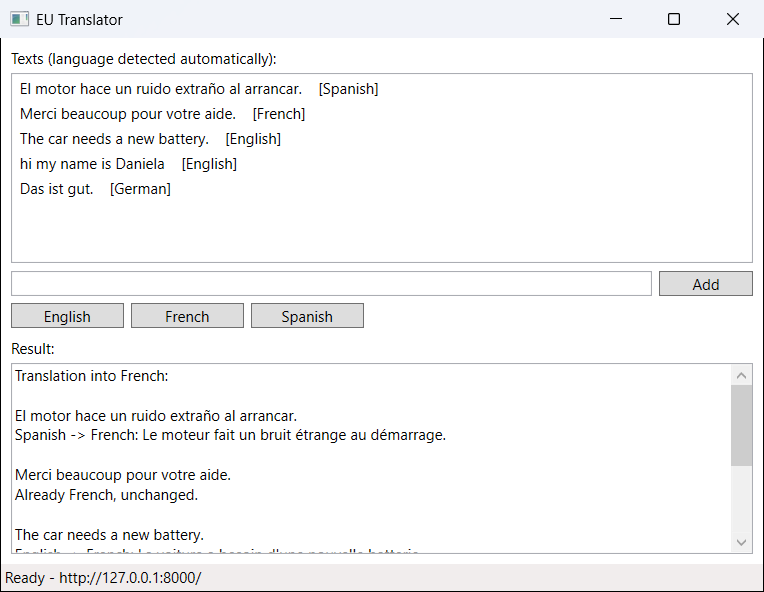
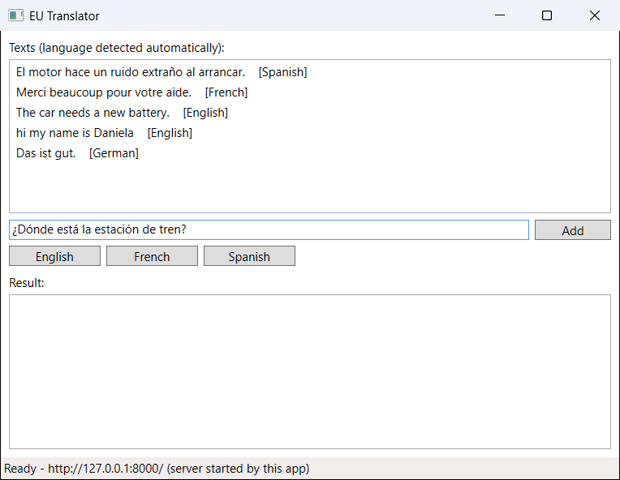

# .NET Desktop App: setup and running

`TranslatorDesktop` is a Windows desktop client (WPF, **.NET 5**) for the Translator API: one
plain window with standard controls and no styles. The API is a separate program
([PYTHON_API_SETUP.md](PYTHON_API_SETUP.md)); when no API is running, the app starts the bundled
`TranslatorServer.exe` itself as a hidden background process and stops it when it closes.



Quickest way to a working app (after `setup.cmd`):

```powershell
.\build_desktop_exe.cmd
publish\TranslatorDesktop\TranslatorDesktop.exe
```

---

## 1. Requirements

| Item | Version | Notes |
|------|---------|-------|
| Windows 10/11 x64 | | WPF is Windows-only |
| .NET SDK (to build) | **.NET 5 SDK 5.0.408** (the last .NET 5 release) | Pinned in [global.json](../global.json). [setup.cmd](../setup.cmd) downloads it into `.dotnet\` in the repository (no admin rights, PC-wide .NET installs untouched) |
| .NET runtime (to run) | **.NET 5.0.17 Desktop Runtime** (included in the SDK in `.dotnet\`) | [run_desktop.cmd](../run_desktop.cmd) starts the app on it. Started directly, the exe uses any installed Desktop Runtime 5 or newer (`RollForward=Major`). The standalone build (section 4) needs no runtime at all. |
| Visual Studio (optional) | 2019 16.8+ / 2022 | Open `Translator.slnx`; needs the .NET 5 SDK, see section 3 |
| The Translator API | `TranslatorServer.exe` (started by the app), or any running API | Default address `http://127.0.0.1:8000` |

.NET 5 has been out of support since May 2022 (no security updates). The project targets it
on request. Moving to .NET 8 or later only needs a change of `TargetFramework` and
`global.json`.

### How setup installs the .NET 5 SDK

`setup.cmd` (or `setup.ps1`) checks for the 5.0.408 SDK in `.dotnet\` or on the PC. If it is
missing, it:

1. downloads `dotnet-sdk-5.0.408-win-x64.zip` (about 190 MB) from
   `https://builds.dotnet.microsoft.com/dotnet/Sdk/5.0.408/`, using `--proxy` if given;
2. checks its SHA-512 hash against the one Microsoft publishes in
   [releases.json](https://builds.dotnet.microsoft.com/dotnet/release-metadata/5.0/releases.json)
   and stops if they differ;
3. unpacks it into `.dotnet\`. The SDK contains runtime 5.0.17: Microsoft.NETCore.App,
   Microsoft.WindowsDesktop.App and Microsoft.AspNetCore.App.

To build only the app (Python part skipped): `.\setup.cmd --skippython`.

## 2. Project files

| File | Purpose |
|------|---------|
| [TranslatorDesktop/TranslatorDesktop.csproj](../TranslatorDesktop/TranslatorDesktop.csproj) | `net5.0-windows`, C# 9, WPF, `RollForward=Major` |
| [TranslatorDesktop/App.xaml](../TranslatorDesktop/App.xaml) / `App.xaml.cs` | Application entry, opens `MainWindow` |
| [TranslatorDesktop/MainWindow.xaml](../TranslatorDesktop/MainWindow.xaml) | Window layout: Label, ListBox, TextBox + Add button, English / French / Spanish buttons, result TextBox, StatusBar. No styles. |
| [TranslatorDesktop/MainWindow.xaml.cs](../TranslatorDesktop/MainWindow.xaml.cs) | Logic: start or find the server, connection monitor, add text + detect, translate, result text |
| [TranslatorDesktop/ServerProcess.cs](../TranslatorDesktop/ServerProcess.cs) | Finds `TranslatorServer.exe`, starts it hidden in the background, ties it to the app with a Windows job object, stops it on close |
| [TranslatorDesktop/TranslatorApi.cs](../TranslatorDesktop/TranslatorApi.cs) | HTTP client for `/health`, `/languages`, `/detect`, `/translate` (System.Text.Json with snake_case names) |
| [TranslatorDesktop/Languages.cs](../TranslatorDesktop/Languages.cs) | Names of the 24 EU languages |
| [global.json](../global.json) | Pins the .NET 5 SDK (5.0.408) |
| [setup.ps1](../setup.ps1) / [setup.cmd](../setup.cmd) | Installs the .NET 5 SDK into `.dotnet\` and builds the app (plus the Python setup) |
| [run_desktop.cmd](../run_desktop.cmd) | Starts the app (Debug build) on the .NET 5 runtime in `.dotnet\` |
| [build_desktop_exe.cmd](../build_desktop_exe.cmd) | Builds the standalone app into `publish\TranslatorDesktop\` with `TranslatorServer.exe` next to it |
| [Translator.slnx](../Translator.slnx) | Solution file for Visual Studio |

## 3. Build and run

From the repository root:

```powershell
.\setup.cmd --skippython          # installs the .NET 5 SDK if needed, then builds
.\run_desktop.cmd                 # starts the app on .NET 5.0.17
```

To build by hand with the SDK in `.dotnet\` (PowerShell):

```powershell
$env:DOTNET_ROOT = "$PWD\.dotnet"; $env:DOTNET_MULTILEVEL_LOOKUP = "0"
.dotnet\dotnet build TranslatorDesktop
```

`DOTNET_MULTILEVEL_LOOKUP=0` makes the SDK use only the runtimes in `.dotnet\`, not the ones
installed on the PC. The plain `dotnet` command uses the PC's own SDKs. Unless a 5.0.408 SDK is
installed there, it fails with "A compatible .NET SDK was not found", because global.json asks
for 5.0.408.

For Visual Studio, open `Translator.slnx` from a window where `DOTNET_ROOT` points at `.dotnet`
and `PATH` starts with it, or install the .NET 5.0.408 SDK on the PC.

### Connecting to the API

The API address is chosen in this order:

1. the command-line argument `--url`, e.g. `TranslatorDesktop.exe --url http://server01:8000`;
2. the environment variable `TRANSLATOR_URL`;
3. the default `http://127.0.0.1:8000`.

The address can point at a single API instance or at the load balancer of a cluster; the app
works the same with both.

### Starting the server in the background

If nothing answers at the API address when the app starts, and the address is on this PC
(`127.0.0.1` / `localhost`), the app starts `TranslatorServer.exe` itself. It looks for it here,
in this order:

1. `--server PATH` on the command line, or the environment variable `TRANSLATOR_SERVER_EXE`;
2. `TranslatorServer\TranslatorServer.exe` next to the app (the layout `build_desktop_exe.cmd`
   makes);
3. `TranslatorServer\dist\TranslatorServer\TranslatorServer.exe` in the app's folder or a parent
   folder (the repository, after `build_server_exe.cmd`; used by the Debug build).

It runs it hidden (no console window) as `TranslatorServer.exe --single --host 127.0.0.1 --port
<port of the API address>`. `--server-args "--instances 2"` (or `TRANSLATOR_SERVER_ARGS`) starts a
cluster instead. The process is assigned to a Windows job object with "kill on job close": when the
app exits, normally or not, Windows ends the server and its child processes. A server that was
already running before the app started is used as it is and never stopped by the app. Server logs
are in `logs\` next to `TranslatorServer.exe`.

## 4. Standalone build (no .NET or Python installation needed)

```powershell
.\build_desktop_exe.cmd                     # builds TranslatorServer.exe first if it is missing
.\build_desktop_exe.cmd --rebuildserver     # also rebuild the server (after changing Python code or models)
.\build_desktop_exe.cmd --proxy http://proxy.corp:8080
```

Result (about 730 MB):

```
publish\TranslatorDesktop\
    TranslatorDesktop.exe                     the app, with the .NET 5.0.17 runtime
    TranslatorServer\TranslatorServer.exe     the API server, with Python, PyTorch and the models
```

Copy the whole folder to any Windows 10/11 x64 PC and run `TranslatorDesktop.exe`. The first build
downloads the .NET runtime packs from api.nuget.org. The script uses the .NET 5 SDK in `.dotnet\`
(`dotnet publish -c Release -r win-x64 --self-contained true`) and `build_server_exe.cmd`
(PyInstaller) for the server.

## 5. Using the app



| Element | What it does |
|---------|--------------|
| **Texts** list (top) | The texts you added, each with its detected language, e.g. `Merci beaucoup.    [French]` |
| Text box + **Add** (or Enter) | Adds the text to the list; its language is detected right away (`POST /detect`), any of the 24 EU languages |
| **English**, **French**, **Spanish** | Translate every text in the list into that language (one `POST /translate` request) |
| **Result** box (bottom) | Per text: the original and `Spanish -> French: <translation>`, or why it was not translated: `Already French, unchanged.`, `German cannot be translated (only English, French and Spanish), unchanged.` |
| Status bar | Server and connection state |

The language buttons are enabled only while the API answers.

| Status bar message | Meaning |
|--------------------|---------|
| `Starting the translation server in the background (...TranslatorServer.exe)...` | No API was running; the app started the server and waits for the models to load (about 10 s) |
| `Ready - http://127.0.0.1:8000/ (server started by this app)` | Ready; closing the app stops that server |
| `Ready - http://127.0.0.1:8000/` | Ready, using an API that was already running |
| `Translation server not running, and TranslatorServer.exe was not found ...` | Build it (`build_server_exe.cmd` / `build_desktop_exe.cmd`) or start an API yourself; the app keeps retrying |
| `Translation server not reachable at ... (retrying...)` | The API stopped or is on another machine that does not answer |
| `The translation server stopped (exit code N) ...` | The server exe failed to start; see its `logs\` folder |

## 6. How the app works

* **Start.** `GET /health` on the API address. If it answers, the app uses that API. If not,
  `ServerProcess` starts `TranslatorServer.exe` in the background (section 3) and the app polls
  `/health` every second until the models are loaded (at most 3 minutes).
* **Connection monitor.** Then `GET /health` every 5 s while the API is up and every 2 s while it is
  down; the language buttons follow the state.
* **Add.** The text is added to the list and sent to `POST /detect`, which returns the language
  code and name; the list item shows the name.
* **Translate.** All texts go to the API in one request
  (`{"text": [[text1, text2, ...]], "target_lang": "fr"}`); the response gives the translation,
  the detected language and whether each text was translated, which make up the result text.
* **Close.** The app stops the server it started (with its child processes). If the app is
  killed, the job object stops it.

## 7. Testing

The app was tested with Windows UI Automation (a PowerShell script that drives the real window),
17 checks per run:
* start with no API running: the app starts `TranslatorServer.exe`, which has no visible window,
  and the status becomes `Ready ... (server started by this app)`;
* the English / French / Spanish buttons are present;
* adding 4 texts: Spanish, French, English and German are detected and shown in the list; the
  input box is cleared;
* French, English and Spanish translations in the result box, including the lines for a text
  already in the target language and for German (not supported);
* closing the window stops the server; in a second run, killing the app process also stops it
  (job object).

All checks passed for the standalone build (`publish\TranslatorDesktop`) and the Debug build
(which found the server in `TranslatorServer\dist\`). A separate run confirmed that with an API
already running, the app uses it, starts no second server and leaves it running when it closes.
The app builds with 0 warnings with the .NET 5.0.408 SDK.

## 8. Troubleshooting

| Problem | Fix |
|---------|-----|
| `A compatible .NET SDK was not found` | The PC-wide `dotnet` was used. Run `.\setup.cmd --skippython`, or build with `.dotnet\dotnet` (section 3) |
| `could not download ... dotnet-sdk-5.0.408` | builds.dotnet.microsoft.com is blocked: `.\setup.cmd --proxy http://host:port`, or copy the zip into `%TEMP%` and run setup again |
| `could not unpack the .NET SDK` | Path too long: move the repository to a short path such as `D:\Translator` |
| `error CS2001: Source file '...MainWindow.g.cs' could not be found` | Built with the .NET 11 SDK, which cannot compile .NET 5 WPF projects. Use the .NET 5 SDK (section 3) |
| `You must install .NET to run this application` | Start it with `run_desktop.cmd`, install any .NET Desktop Runtime (5 or newer), or use the standalone build (section 4) |
| `TranslatorServer.exe was not found` | Run `build_desktop_exe.cmd` (or `build_server_exe.cmd` for the Debug build), or start an API yourself (`TranslatorServer\start_cluster.bat`), or pass `--server PATH` |
| Status stays at "not reachable" with `--url http://other-pc:8000` | Start the API on that PC, and check that its firewall allows the port; the app only starts a local server for a local address |
| `The translation server stopped (exit code ...)` | See `logs\api.log` next to `TranslatorServer.exe`; for example the port is used by another program: start the app with `--url http://127.0.0.1:8080` |
| Language buttons disabled | Not connected yet; see the status bar |
| `build_desktop_exe.cmd`: `TranslatorDesktop.exe is running` | Close the app first |
| A text is listed as unchanged, "cannot be translated" | The detected language (e.g. German) is not one the model translates (only English, French, Spanish) |
