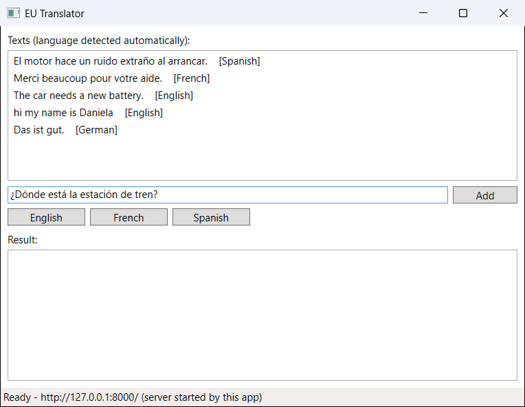
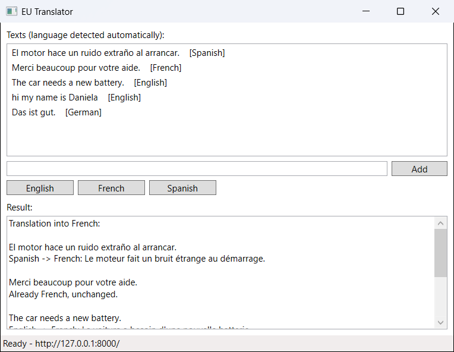
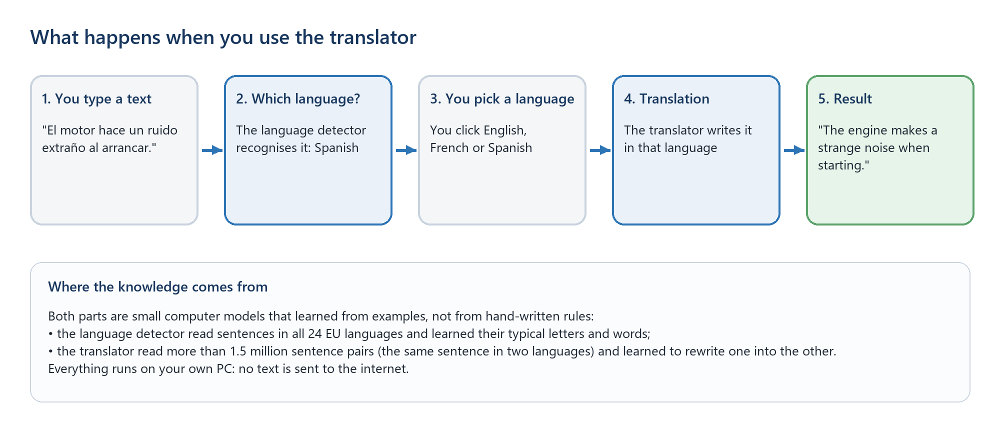
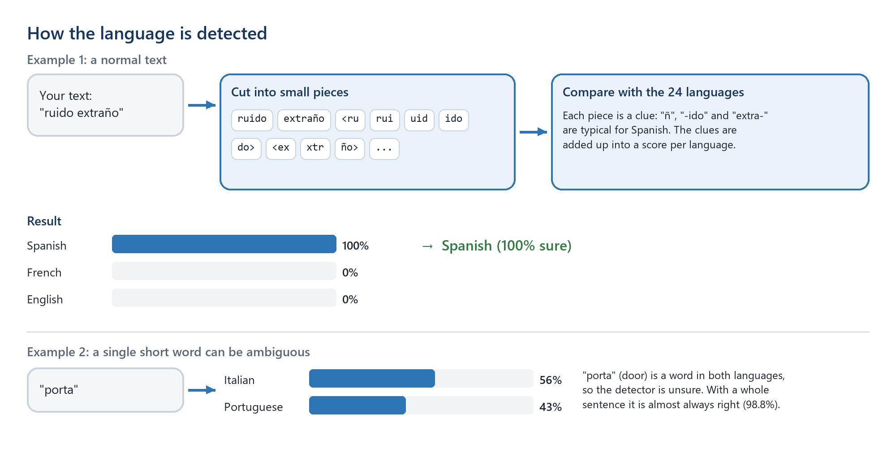
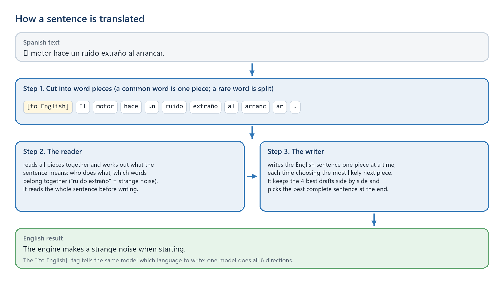
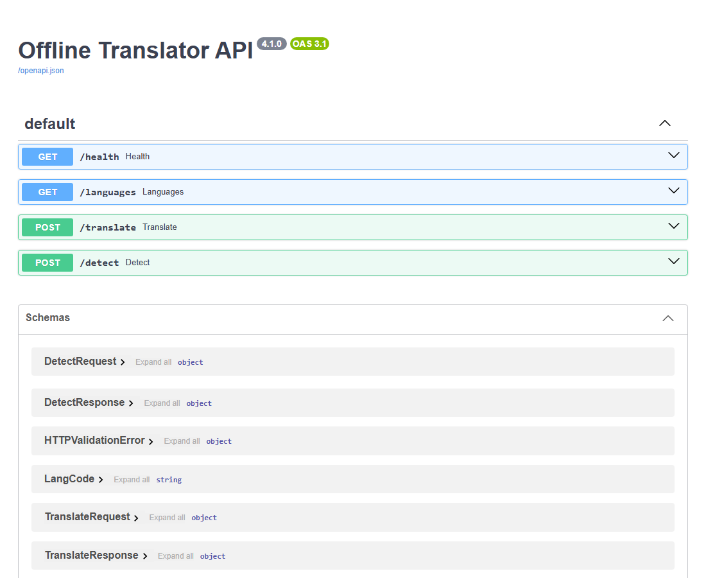

# How the translator works, in plain words

This page explains, without technical background, what the EU Translator does, how it recognises
a language, how it translates, where it learned this, and how good it is. The other documents
give the technical details.

---

## 1. What it does

You type or paste a text in any of the 24 official EU languages. The translator:

1. **recognises the language** of the text (for example Spanish), right away;
2. **translates** it into **English, French or Spanish**, whichever you choose.

It runs completely on your own computer. No text is sent to the internet, and it keeps working
without a network connection.

*The app after adding five texts. Next to each text is the language it was recognised as. The
text in the box below the list has been typed but not added yet.*

*After clicking **French**: the result box shows each text and its French translation. A text that
is already French is left as it is; German is recognised but cannot be translated (the translator
knows only English, French and Spanish).*

The whole process at a glance:

The app is only the window you work in. The actual work is done by a separate program in the
background, the **translation server**. The app starts it by itself and stops it when you close
the app. Other programs can use the same server too (section 6).

## 2. How the language is recognised

Every language has its own typical letters and letter combinations. Spanish has "ñ" and many
words ending in "-ido" or "-ción"; German has "sch" and "ß"; Polish has "ł" and "szcz". A person
who has seen many languages can often tell which one a text is in without understanding it. The
**language detector** does the same thing:

1. It cuts the text into small pieces: the whole words, and every group of 2 to 4 letters inside
   each word ("ruido" gives "ru", "rui", "uid", "ido", ...).
2. For every piece it has learned how typical it is for each of the 24 languages. It adds these
   clues up into a score per language.
3. The language with the highest score wins. The score also says how sure it is.

A whole sentence contains dozens of clues, so the detector is almost always right (98.8% of
test sentences). A single short word can belong to several languages: "porta" (door) is both
Italian and Portuguese, so the detector is unsure, and "no" is English and Spanish. For very short
texts it slightly prefers English, French and Spanish, the three languages the translator works
with, because those are the most likely ones in this application.

The detector learned the typical letter groups by reading about 40,000 example sentences for
each language (120,000 for English, French and Spanish), plus hand-written greetings and short
phrases such as "hi there" or "merci beaucoup".

## 3. How a sentence is translated

The translator does not look words up in a dictionary and does not follow grammar rules written
by people. It is a **neural network**: a large set of numbers that was adjusted, during training,
until it produced good translations for millions of examples. It works in three steps:

1. **Cut into word pieces.** Common words are one piece ("motor", "ruido"); rare words are split
   into parts ("arranc" + "ar"). With 16,000 different pieces it can write any word, even names it
   has never seen, such as "Daniela". In front it adds a tag that says which language to write
   ("to English").
2. **The reader** (in technical terms, the *encoder*) reads all pieces together and works out what
   the sentence means: which words belong together, who does what. It always reads the whole
   sentence before anything is written, so word order and context are taken into account.
3. **The writer** (the *decoder*) writes the translation one piece at a time. At every step it
   picks the pieces that fit best with the meaning and with what it has already written. It keeps
   the 4 best drafts side by side and chooses the best complete sentence at the end
   (*beam search*).

Longer texts are first split into sentences, and each sentence is translated on its own. The same
model handles all six directions (English, French and Spanish into each other); only the tag in
step 1 changes.

### How it learned

The translator was shown more than 1.5 million pairs of sentences: the same sentence in two
languages, for example a Spanish sentence and its English translation. For each pair it tried to
write the translation, compared its attempt with the real one, and adjusted its numbers a little
to do better next time. This was repeated millions of times over 17 hours. Nobody wrote rules or
word lists for it: everything it knows comes from these examples.

On top of the general sentences, it was trained with a few thousand sentences about car service
(engines, brakes, appointments), greetings and introductions, so it handles this subject well, and
with examples of names, so it copies names instead of translating them ("hi my name is Daniela" →
"Hola, me llamo Daniela.").

## 4. Where the training examples come from

All training data are public and were downloaded from GitHub:

| Data | What it is | Used for | GitHub address |
|------|------------|----------|----------------|
| **Tatoeba** | A collection of short everyday sentences translated by volunteers | Translation (everyday language) and language detection | https://github.com/Helsinki-NLP/Tatoeba-Challenge https://github.com/viljarpuusepp/Attention https://github.com/doozan/spanish_data |
| **Europarl** | Speeches of the European Parliament, published in all EU languages | Translation (formal language) and detection of German, Italian, Dutch, Portuguese | https://github.com/UDS-SFB-B6-Datasets/Multilingual-Parallel-Direct-Europarl |
| **Universal Dependencies** | Collections of sentences in many languages made by language researchers | Language detection (all 24 languages) | https://github.com/UniversalDependencies (28 collections, e.g. https://github.com/UniversalDependencies/UD_Irish-IDT) |
| Hand-written examples | Car-service sentences, greetings, names, short phrases | Translation and detection of the everyday cases this tool is used for | in this repository: `TranslatorTraining/domain_data.py`, `TranslatorTraining/lid_phrases.tsv` |

The exact address of each of the 70 downloaded files is listed in
[MODEL_TRAINING.md, section 3](MODEL_TRAINING.md#download-addresses-of-every-file).

Some sentences of each source were kept aside and never shown to the models during training. They
are used only to test the models afterwards, like an exam with questions the student has not seen
before.

## 5. How good it is

| Test | Result | In plain words |
|------|--------|----------------|
| Language detection, 24 languages | 98.8% correct | About 1 mistake in 100 sentences; most mistakes are between very similar languages (Slovenian and Croatian) |
| Detection of everyday phrases (English, French, Spanish) | 146 of 150 correct | Short greetings and phrases are recognised well |
| Translation, car-service sentences | BLEU 67.7 | Very high quality; most sentences come out right |
| Translation, everyday sentences | BLEU 41.7 | Good; short sentences are usually correct, with occasional grammar slips |
| Translation, formal parliament texts | BLEU 29.9 | Understandable, but long sentences contain errors |

**BLEU** is the standard score for machine translation. It compares the translation with a
translation made by a person and counts how many words and word sequences agree, on a scale from
0 to 100. Even a perfect translation rarely reaches 100, because a sentence can be translated
correctly in many ways and BLEU only counts the words that match the one reference. A common
rule of thumb: 30–40 is understandable to good, 40–50 good to high quality, above 50 very high
quality.

What to expect:
* short, everyday sentences and car-service texts: mostly correct;
* names: copied correctly;
* long, complicated sentences: the meaning comes through, but with mistakes;
* only English, French and Spanish can be translated; texts in the other 21 languages are
  recognised but left unchanged;
* it is much smaller than large online translators, so it is less fluent than they are, but it
  is private and works offline.

## 6. The parts and how they fit together

| Part | What it is |
|------|------------|
| **Desktop app** (`TranslatorDesktop.exe`) | The window you work in |
| **Translation server** (`TranslatorServer.exe`) | Runs in the background and does the detection and translation. Other programs can use it too, through its web interface (the *API*). |
| **Models** (`TranslatorServer/models/`) | The trained detector (65 MB) and translator (22 MB): the "knowledge" learned from the examples |
| **Training scripts** (`TranslatorTraining/`) | Only needed to train the models again: they download the examples and run the training |

The server has a built-in help page that lists everything it offers. While it is running, open
`http://127.0.0.1:8000/docs` in a browser:

* **/translate**: translate texts;
* **/detect**: only recognise the language;
* **/languages**: which languages it knows;
* **/health**: whether it is running and ready.

When many people use one server, it can run several copies of the translator side by side, with a
**load balancer** in front that hands each request to a free copy. If one copy fails, the others
take over and the failed copy is restarted automatically.

## 7. Words used in the other documents

| Term | Meaning |
|------|---------|
| API | The way programs talk to the server: they send a request (a text) over the network connection and get an answer (the translation) |
| Model | The trained network with its learned numbers, saved as files in `models/` |
| Training | Showing the model many examples and adjusting it until its answers are good |
| Neural network | A program made of many simple connected calculations whose numbers are learned from examples |
| Encoder / decoder | The "reader" and "writer" parts of the translator (section 3) |
| Transformer | The kind of neural network the translator uses; the same basic design as most modern translators |
| Token / word piece | A word or part of a word, the unit the translator reads and writes |
| Beam search | Keeping several drafts while writing and choosing the best one at the end |
| Dataset / corpus | A collection of example sentences |
| Held-out / test set | Examples kept aside for testing and never used for training |
| BLEU / chrF | Scores from 0 to 100 that compare a machine translation with a human one (chrF compares letters instead of words) |
| CPU / GPU | The computer's main processor / its graphics card; training is much faster on a graphics card, using the translator needs only the processor |
| Instance | One running copy of the translator inside the server |
| Load balancer | The part that spreads requests over several instances |
| Proxy | A company gateway that internet traffic must pass through; the setup and download scripts accept its address with `--proxy` |
