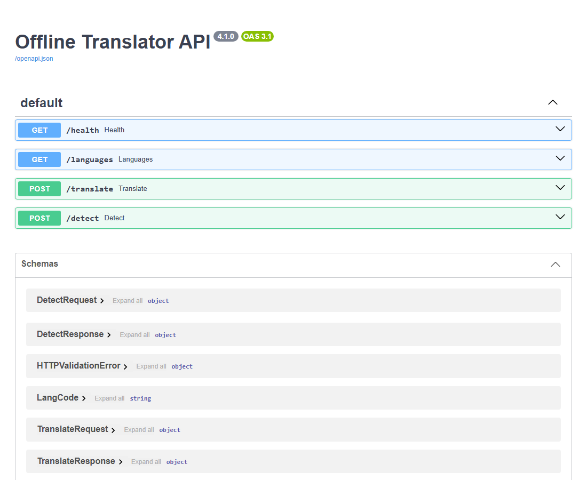

# Python Translator API: setup and running

> **In plain words:** the API is the translation server, the program that does the actual work
> in the background. The desktop app (or any other program) sends it a text and gets back the
> language and the translation. This document explains how to install it, start it and talk to it.
> How detection and translation work inside is explained in [HOW_IT_WORKS.md](HOW_IT_WORKS.md).

The API translates text between **English, Spanish and French** (all 6 directions) and
automatically detects the language of each sentence among the **24 official EU languages**.
It runs fully offline with our own trained models.

Everything here happens in the `TranslatorServer/` folder (the training scripts are in
`TranslatorTraining/`). To build the desktop client, see
[DOTNET_APP_SETUP.md](DOTNET_APP_SETUP.md). To train the models yourself, see
[MODEL_TRAINING.md](MODEL_TRAINING.md). For how the parts work together, see
[ARCHITECTURE.md](ARCHITECTURE.md).

---

## 1. Requirements

| Item | Requirement | Notes |
|------|-------------|-------|
| Operating system | Windows 10/11 x64 | Linux/macOS also work (use the `uvicorn` / `python` commands instead of the `.bat` files) |
| Python | 3.11 or newer | https://www.python.org/downloads/; tick "Add python.exe to PATH". Not needed for the bundled exe. |
| Processor and memory | 4 cores and 8 GB RAM recommended | No graphics card needed to run the API |
| Disk | ~1.5 GB | Python environment ~1.3 GB (PyTorch) + models 86 MB |

Installed Python packages ([TranslatorServer/requirements.txt](../TranslatorServer/requirements.txt)):

| Package | Version | Purpose |
|---------|--------------|---------|
| fastapi | 0.162.4 | REST API framework |
| uvicorn[standard] | 0.54.0 | HTTP server |
| torch (CPU build) | 2.15.0+cpu | Runs the neural networks |
| sentencepiece | 0.2.3 | Tokenizer for the translation model |
| numpy | 2.5.4 | Arrays |
| httpx | 0.28.1 | Load balancer HTTP client, tests |
| pytest | 8.x | Tests |

## 2. Install

`setup.cmd --skipdotnet` (repository root) does all of this. By hand:

```powershell
cd TranslatorServer
python -m venv .venv
.venv\Scripts\activate
python -m pip install --upgrade pip
pip install -r requirements.txt
```

The default `torch` wheel on Windows is the CPU build. That is all the API needs.

### Models

The API loads two model folders from `TranslatorServer/models/`:

| Folder | Files | Size | Made by |
|--------|-------|------|---------|
| `models/nmt-en-es-fr/` | `model.pt` (weights, fp16), `spm.model` (tokenizer), `config.json` | 22 MB | [TranslatorTraining/train_nmt.py](../TranslatorTraining/train_nmt.py) |
| `models/lid/` | `lid.pt` (weights, fp16), `config.json` | 65 MB | [TranslatorTraining/train_lid.py](../TranslatorTraining/train_lid.py) |

The trained models are in the repository, so the API works right after cloning. To create them
from scratch, follow [MODEL_TRAINING.md](MODEL_TRAINING.md). To use models stored elsewhere,
set `TRANSLATOR_MODEL_DIR`.

### Offline machine

On a machine with internet:

```powershell
pip download -r requirements.txt -d wheels
```

Copy the `wheels/` folder, `models/` and the code to the offline machine, then:

```powershell
python -m venv .venv
.venv\Scripts\pip install --no-index --find-links wheels -r requirements.txt
```

## 3. Run

There are two ways to run the API. Both listen on **http://127.0.0.1:8000**, which the
desktop app uses by default.

### a) Single instance

```powershell
start_api.bat              # port 8000
start_api.bat 8080         # another port
```

This is the same as `.venv\Scripts\python -m uvicorn app:app --host 127.0.0.1 --port 8000`.

### b) Cluster: several instances behind a load balancer (recommended)

```powershell
start_cluster.bat          # 2 instances
start_cluster.bat 4        # 4 instances
```

This is the same as `.venv\Scripts\python cluster.py --instances 4 --port 8000`. It starts:

* N API instances (`app.py`) on ports 8001…800N, listening on 127.0.0.1 only;
* the load balancer (`loadbalancer.py`) on port 8000;
* a supervisor that restarts any instance that crashes.

Use 1 instance per 1–2 CPU cores. Each instance needs about 500 MB of RAM.

To accept connections from other machines, set the host before starting, and allow the port
in Windows Firewall:

```powershell
$env:TRANSLATOR_HOST = "0.0.0.0"     # in cmd.exe: set TRANSLATOR_HOST=0.0.0.0
start_cluster.bat 4
```

Stop with **Ctrl+C** in the console window.

### Check that it works

```powershell
curl http://127.0.0.1:8000/health
curl http://127.0.0.1:8000/lb/status          # cluster only
```

Interactive API documentation is at http://127.0.0.1:8000/docs. It lists every endpoint and
lets you try them in the browser:



### c) Bundled exe: no Python needed

`build_server_exe.cmd` (repository root) packs the server, Python, PyTorch and the models into one
folder with an exe, built with PyInstaller:

```powershell
.\build_server_exe.cmd                          # once; a few minutes; needs TranslatorServer\.venv
.\build_server_exe.cmd --proxy http://proxy.corp:8080   # if pip needs a proxy to get PyInstaller
```

Result: `TranslatorServer\dist\TranslatorServer\` (about 580 MB) with `TranslatorServer.exe`,
`_internal\` (Python and the packages) and `models\`. Copy the whole folder to run it on another
Windows 10/11 x64 PC; nothing needs to be installed there.

```powershell
.\run_server.cmd                               # cluster: 2 instances + load balancer on :8000
.\run_server.cmd --instances 4
.\run_server.cmd --instances 4 --host 0.0.0.0  # reachable from other machines
.\run_server.cmd --single --port 8000          # one instance, no load balancer
TranslatorServer\dist\TranslatorServer\TranslatorServer.exe --help
```

`run_server.cmd` only starts `TranslatorServer\dist\TranslatorServer\TranslatorServer.exe` with the
same options. The exe runs the same code as the `.bat` files (`server_main.py` is its entry point):
the cluster supervisor starts the instances and the load balancer as further
`TranslatorServer.exe` processes. Models are read from `models\` and logs written to `logs\`, both
next to the exe; `TRANSLATOR_MODEL_DIR` and `TRANSLATOR_LOG_DIR` override them. After retraining,
copy the new `TranslatorServer\models\` into the exe folder (or run `build_server_exe.cmd` again).

It is a one-folder build on purpose: the cluster runs several processes of the same exe, and a
single-file exe would unpack about 580 MB into `%TEMP%` for each of them.

## 4. Using the API

### `POST /translate`

```json
{
  "text": [["The car needs a new battery.", "Merci beaucoup."], ["Das ist gut."]],
  "target_lang": "es"
}
```

| Field | Required | Description |
|-------|----------|-------------|
| `text` | yes | Array of arrays of sentences (`string[][]`). The response has the same shape. |
| `target_lang` | yes | `en`, `es` or `fr` |
| `source_lang` | no | Skip detection and treat every sentence as this language |
| `detect_mode` | no | `"sentence"` (default): detect each sentence. `"group"`: one detection per inner array (better for very short sentences). |

Response:

```json
{
  "target_lang": "es",
  "translation":   [["El coche necesita una batería nueva.", "Muchas gracias."], ["Das ist gut."]],
  "detected_lang": [["en", "fr"], ["de"]],
  "confidence":    [[0.99, 0.98], [0.99]],
  "translated":    [[true, true], [false]]
}
```

`translated` is `false` when a sentence is returned unchanged:
* it is already in the target language;
* it has no letters;
* it is in a detected language the model cannot translate (here German).

Every response has an `X-Request-ID` header. Through the cluster it also has `X-Backend`,
showing which instance handled it.

| Status | When |
|--------|------|
| 200 | OK |
| 413 | More than `MAX_SENTENCES` sentences in one request |
| 422 | Invalid input: target not en/es/fr, flat list instead of `string[][]`, no sentences, bad `detect_mode` |
| 503 | Models missing, or (cluster) no healthy instance |

PowerShell example:

```powershell
$body = '{"text":[["El motor hace un ruido extraño al arrancar."]],"target_lang":"en"}'
Invoke-RestMethod http://127.0.0.1:8000/translate -Method Post `
  -ContentType "application/json; charset=utf-8" -Body ([Text.Encoding]::UTF8.GetBytes($body))
```

### Other endpoints

| Endpoint | Returns |
|----------|---------|
| `GET /health` | `status` (`ok` / `model_missing`), instance name, model training info (step, dev BLEU), device, threads, beam size |
| `POST /detect` | Language detection only: `{"text": ["El motor...", "Das ist gut."]}` → `detected_lang` (`["es", "de"]`, `und` = no letters), `language` (`["Spanish", "German"]`), `confidence`, `translatable` (`[true, false]`). Used by the desktop app when a text is added. |
| `GET /languages` | `languages`: what can be translated (en, es, fr); `detectable`: the 24 detected languages |
| `GET /lb/status` | (cluster only) every instance: health, requests in progress, total requests, errors, average latency |

## 5. Configuration (environment variables)

| Variable | Default | Meaning |
|----------|---------|---------|
| `TRANSLATOR_HOST` | `127.0.0.1` | Address that `start_api.bat` / the load balancer listens on |
| `TRANSLATOR_MODEL_DIR` | `TranslatorServer/models` (exe: `models\` next to it) | Folder containing `nmt-en-es-fr/` and `lid/` |
| `TRANSLATOR_BEAM_SIZE` | `4` | Beam search width; `1` = greedy (about 2× faster, slightly worse) |
| `TRANSLATOR_THREADS` | CPU cores / 2 (cluster: cores / instances) | PyTorch threads per instance |
| `TRANSLATOR_BATCH_SIZE` | `32` | Sentences translated together |
| `TRANSLATOR_CACHE_SIZE` | `20000` | Cached sentence translations per instance (`0` = off) |
| `MAX_SENTENCES` | `10000` | Maximum sentences per request |
| `PRELOAD_MODELS` | `1` | Load the models at startup (`0` = on first request) |
| `TRANSLATOR_INSTANCES` | `2` | Default instance count for `cluster.py` |
| `TRANSLATOR_INSTANCE` | `api` | Instance name in logs (set by `cluster.py`) |
| `TRANSLATOR_LOG_DIR` | `TranslatorServer/logs` (exe: `logs\` next to it) | Log folder |
| `TRANSLATOR_LOG_LEVEL` | `INFO` | `DEBUG` also logs the health checks |

## 6. Logs

Each process writes one JSON object per line to `TranslatorServer/logs/` and readable lines to
the console. Files rotate at 10 MB, keeping 5 old files.

| File | Contents |
|------|----------|
| `loadbalancer.log` | Every request: request id, instance chosen, status, latency, retries. Instances going down or up. |
| `api-8001.log`, `api-8002.log`, … | Every request; for `/translate` also sentence count, characters, target, detected languages, duration. Model loading. Errors with traceback. |
| `api.log` | The single instance (`start_api.bat`) |
| `cluster.log` | Processes started, crashed (exit code) and restarted |
| `loadtest.jsonl` | Results of `tools/loadtest.py` |

Example line:

```json
{"ts": "2026-11-14T20:29:23.929+05:30", "level": "INFO", "logger": "translator.api", "instance": "api-8001",
 "msg": "translated 10 sentence(s) to fr", "request_id": "e64b3d57c48d47ef", "sentences": 10,
 "target": "fr", "detected": {"en": 10}, "translated": 10, "duration_ms": 2459.1}
```

To follow one request through the load balancer and the instance:

```powershell
Select-String e64b3d57c48d47ef logs\*.log
```

The translated text is never written to the logs; only counts and languages are.

## 7. Tests and checks

```powershell
.venv\Scripts\python -m pytest -q                   # 39 tests: API end to end + load balancer
.venv\Scripts\python tools\loadtest.py              # load test (API must be running)
..\TranslatorTraining\.venv\Scripts\python ..\TranslatorTraining\score_api.py   # translation score through the API
```

| File | What it tests |
|------|---------------|
| [tests/test_api.py](../TranslatorServer/tests/test_api.py) | Detection of all 24 languages, translation in all directions, shape of `string[][]`, validation errors, cache, request id and log entry |
| [tests/test_loadbalancer.py](../TranslatorServer/tests/test_loadbalancer.py) | Even spreading, failover when an instance dies, 503 when none are up, request id forwarding, `/lb/status` (fake instances, no models needed) |
| [tools/loadtest.py](../TranslatorServer/tools/loadtest.py) | Scenarios: ramp (1–64 concurrent), spike, large requests, mixed valid/invalid, soak, chaos (kills instances) |
| [TranslatorTraining/score_api.py](../TranslatorTraining/score_api.py) | BLEU / chrF and detection accuracy on the 6,270-sentence test set, through the API |

### Measured results (4-core processor, 4 instances)

| Test | Result |
|------|--------|
| Throughput | ~61 sentences/s (single instance: ~31) |
| 64 concurrent users | 0 errors, median 10.2 s |
| 200-request spike | 0 errors |
| 9-minute soak | 3,239 requests, 0 errors |
| Chaos: 6 instances killed during load | 788 requests, 0 errors (24 automatic retries) |
| Translation score through the API | BLEU 32.7, chrF 58.1; source language detected correctly for 99.4% |

## 8. Troubleshooting

| Problem | Fix |
|---------|-----|
| `/health` returns `model_missing` | `models/nmt-en-es-fr/` or `models/lid/` is missing: copy them, or train them ([MODEL_TRAINING.md](MODEL_TRAINING.md)) |
| `Python environment not found` from the `.bat` files | Create `.venv` (section 2) |
| `run_server.cmd`: `TranslatorServer.exe has not been built yet` | Run `build_server_exe.cmd` first |
| `build_server_exe.cmd`: `TranslatorServer.exe is running` | Stop the running server (Ctrl+C in its window), then build again |
| Port 8000 already in use | `start_api.bat 8080` or `cluster.py --port 8080`, and start the app with `--url http://127.0.0.1:8080` |
| Other PCs cannot connect | `$env:TRANSLATOR_HOST = "0.0.0.0"` (cmd.exe: `set TRANSLATOR_HOST=0.0.0.0`) and open the port in Windows Firewall |
| Slow under load | Use `start_cluster.bat` with more instances (up to the number of cores), or `TRANSLATOR_BEAM_SIZE=1` |
| `/lb/status` shows an instance unhealthy | Check `logs/api-80xx.log` and `logs/cluster.log`; the supervisor restarts crashed instances automatically |
